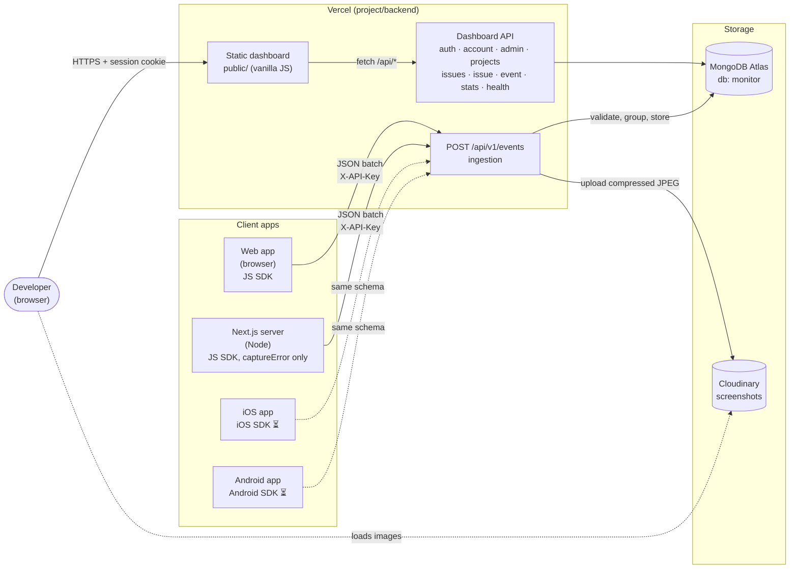
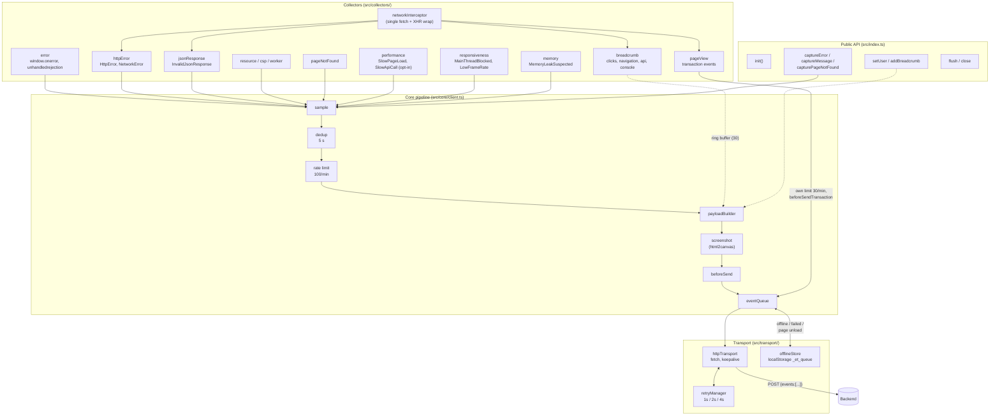
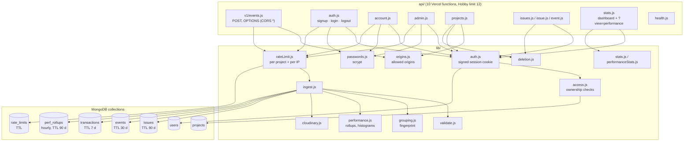
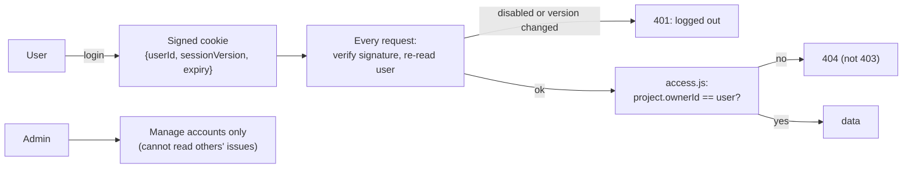
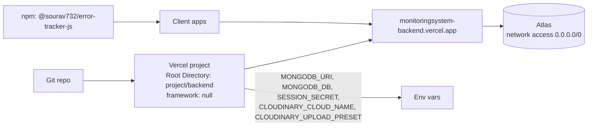

# Architecture

How the in-house error tracker fits together: client SDKs in the apps, one ingestion API, MongoDB, and a dashboard.
For the wire format and the technical rules behind each part, see [PROTOCOL.md](PROTOCOL.md). For the original requirements, see [SPEC.md](SPEC.md).

Diagrams are written in [Mermaid](https://mermaid.js.org/) (GitHub and VS Code render them).

---

## 1. System overview



| Part | Path | Stack | Status |
| --- | --- | --- | --- |
| JS SDK | `error-tracking-sdk/js/` | TypeScript → ES5, Rollup (ESM + CJS), zero runtime deps | ✅ 0.6.1 |
| iOS SDK | `error-tracking-sdk/ios/` | Swift 5.5+, iOS 14+ | ⏳ not started |
| Android SDK | `error-tracking-sdk/android/` | Kotlin 1.8+, API 21+ | ⏳ not started |
| Backend + dashboard | `project/backend/` | Vercel functions (plain JS, ES modules), only dependency `mongodb` | ✅ deployed |
| Demo app | `project/web/` | Next.js 15 (App Router) using the JS SDK | ✅ |

---

## 2. JS SDK internals



Shared helpers in `core/`: `reportedErrors` (one failure, one event), `visibility` (hidden-tab periods), `stackParser`, `serialize`, `device`, `safe` (wraps every SDK call so it can never throw into the host app), `logger` (silent unless `debug: true`).

Automatic collectors are only installed when `window` exists. In Node (Next.js `onRequestError`), only `captureError` is used.

---

## 3. Backend internals



---

## 4. Event lifecycle (error event)

```mermaid
sequenceDiagram
    autonumber
    participant App as Host app
    participant SDK as JS SDK
    participant LS as localStorage
    participant API as POST /api/v1/events
    participant DB as MongoDB
    participant CL as Cloudinary

    App->>SDK: throws TypeError
    SDK->>SDK: sample → dedup → rate limit → build payload
    SDK->>SDK: screenshot, if enabled and unhandled (masked, ≤1280 px, JPEG 0.5)
    SDK->>SDK: beforeSend → queue (batch of 10 or 2 s)
    SDK->>API: POST { events: [...] }  X-API-Key
    alt network error / 5xx / 408 / 429
        API-->>SDK: failure
        SDK->>SDK: retry after 1 s, 2 s, 4 s
        SDK->>LS: still failing → persist (max 50, key removed)
    else other 4xx
        API-->>SDK: 400 / 401 / 403 (incl. origin_not_allowed) / 413
        SDK->>SDK: drop, no retry
    end
    API->>DB: look up project by SHA-256(API key)
    API->>API: Origin in the project's allowed origins? (else 403)
    API->>DB: consume per-IP budget (150/min; no per-project error limit)
    API->>API: validate each event (bad ones rejected individually)
    API->>CL: upload screenshot (≤400 KB)
    API->>DB: upsert issue by fingerprint (reopen if resolved)
    API->>DB: insert event (+ screenshot URL)
    API-->>SDK: 202 { accepted, rejected: [{index, reason}] }
```

Page views (`event_type: "transaction"`) take a different branch at the server: they never become issues. They are stored in `transactions` (for "slowest samples") and added to hourly `perf_rollups`, which feed the Performance view.

---

## 5. Dashboard access model



---

## 6. Deployment



- The JS SDK ships on npm (or a CDN such as jsDelivr); the user publishes it from their own account.
- Locally, `project/backend/dev-server.js` (Node `http`) mimics Vercel routing on port 4000.
- The demo app (`project/web/`) links the SDK via `file:../../error-tracking-sdk/js` and sends to the deployed backend.
